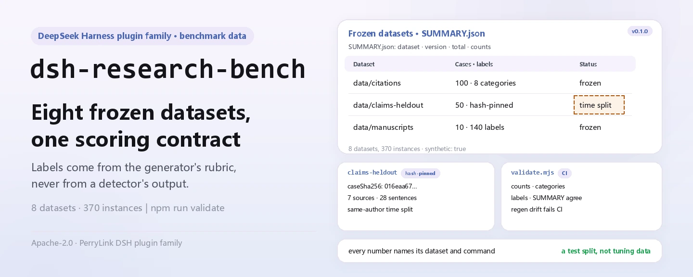
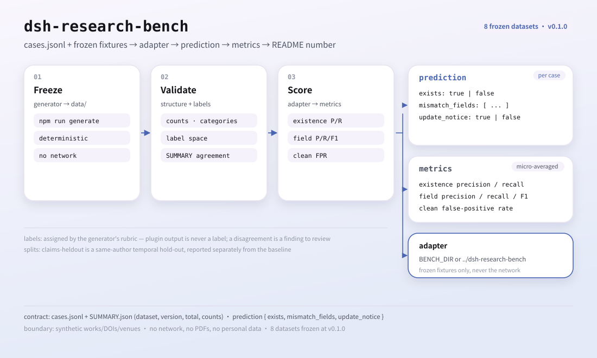

<div align="center">

<picture>
  <source media="(prefers-color-scheme: dark)" srcset="docs/assets/dsh-research-bench-hero-en-dark.webp">
  
</picture>

# dsh-research-bench

**Benchmarks abiertos, sintéticos y congelados para la familia de plugins de investigación de DSH.**

*Datos + rúbrica + un contrato de puntuación — no es un plugin. El README de un detector solo puede citar números producidos por este repositorio.*

[English](README.md) · [简体中文](README-zh.md) · [Español](README-es.md) · [Português](README-pt.md) · [हिन्दी](README-hi.md)

[](LICENSE)
[]()

</div>

---

## Por qué existe

Cada plugin de la familia afirma *verificar* algo. Una afirmación sin medición es marketing, así que:

- los conjuntos de datos son **sintéticos y congelados** (sin PDFs con derechos de autor, sin datos personales, sin corpus extraídos de la web);
- las etiquetas vienen de la **rúbrica del generador**, nunca de la salida de un plugin;
- todo plugin que quiera publicar exactitud debe incluir un **adaptador** que lea estos archivos e imprima una matriz de confusión;
- los números en el README de un plugin deben indicar la versión del conjunto de datos y el comando exacto.


<picture>
  <source media="(prefers-color-scheme: dark)" srcset="docs/assets/dsh-research-bench-flow-v5-dark.svg">
  
</picture>

*Estructura: congelar → validar → puntuar. Entran `cases.jsonl` y los fixtures de proveedor congelados; salen una predicción por caso (`exists`, `mismatch_fields`, `update_notice`) y métricas promediadas micro. Las etiquetas vienen de la rúbrica del generador, nunca de un plugin, y todo número publicado debe indicar la versión del conjunto de datos y el comando que lo produjo.*

## Conjuntos de datos

| Conjunto | Casos | Estado | Consumidor |
|---|---:|---|---|
| `data/citations` | **100** | ✅ congelado | `dsh-cite-verify` |
| `data/stats` | **30** | ✅ congelado | `dsh-statcheck` |
| `data/claims` | **50** | ✅ congelado | `dsh-claim-check` |
| `data/images` | **100 pares** | ✅ congelado | `dsh-image-integrity` |
| `data/meta` | **20** | ✅ congelado | `dsh-meta-analysis` |
| `data/claims-heldout` | **50** | ✅ congelado | `dsh-claim-check` (conjunto de retención separado) |
| `data/repro` | 10 | 🚧 con `dsh-repro-audit` (W2) | `dsh-repro-audit` |
| `data/manuscripts` | **10** | ✅ congelado | `dsh-manuscript-check` |
| `data/figures` | 100 pares | 🚧 con `dsh-image-integrity` (W4) | `dsh-image-integrity` |

### `data/repro` (v0.1.0, congelado)

Diez fixtures de proyecto basados en recetas, materializados en un directorio temporal (sin `.git` confirmado): limpio, sin seed/lockfile, sin git, árbol sucio, sin comando de ejecución/anclaje de entorno, y tres casos de deriva posteriores al manifiesto. Los niveles y los conjuntos exactos de gaps los asigna la receta; el README del plugin reporta exactitud de nivel, precision/recall de gaps, detección de deriva y el requisito previo de git.

### `data/manuscripts` (v0.1.0, congelado)

Diez manuscritos sintéticos con 140 etiquetas de ítem (14 ítems de estructura/declaración cada uno) y `missingCoreSections` a nivel de documento. Las etiquetas se asignan por construcción en el generador, no por el detector. El README del plugin reporta precision/recall de `present`/`missing` a nivel de ítem y declara que esto es una base de regresión de detección por palabras clave, no una auditoría de cumplimiento.

### `data/claims-heldout` (v0.1.0, congelado)

50 pares claim/source nuevos escritos después de congelar la base, con 7 fuentes sintéticas nuevas y sin reutilización literal. El archivo está fijado por hash en `SUMMARY.json`, y el runner se niega a ejecutar si el hash cambió. Es un **time-split del mismo autor**, no una estimación ciega ni insesgada: el autor leyó la implementación antes de escribir los casos. Los resultados se reportan por separado de la base.

### `data/meta` (v0.1.0, congelado)

20 metaanálisis sintéticos (153 filas de estudio) que abarcan homogeneidad, heterogeneidad media/alta, efectos cero/negativos, k=2/5/10/12 y SEs iguales/desiguales. Las estimaciones esperadas fijas/aleatorias, Q, I² y τ² las calcula una implementación cerrada independiente en el generador, no el plugin; el README del plugin reporta el error absoluto máximo medido y los límites (mismo modelo DL, sin datos faltantes).

### `data/images` (v0.1.0, congelado)

100 pares de PNG sintéticos de 64×64: 25 pares de bloques duplicados, 25 de bloques reflejados, 25 no relacionados y 25 negativos difíciles que solo comparten bordes planos. Las etiquetas vienen del generador, nunca del detector. El README del propio detector debe citar la precision/recall y la FPR medidas, y debe indicar que los fixtures están alineados a la rejilla y sin comprimir.

### `data/claims` (v0.1.0, congelado)

50 afirmaciones sobre cinco párrafos sintéticos: 15 respaldadas (`verified`), 10
paráfrasis (**`insufficient` por diseño** — v0.1 no hace semántica), 8 con
números erróneos (`disproven`), 7 con negación invertida y 5 con citas sesgadas (`contradicted`),
5 con contenido ausente (`insufficient`). Esquema:
[`schema/claim-case.schema.json`](schema/claim-case.schema.json); reglas y la
advertencia de validez: [`rubric/CLAIMS.md`](rubric/CLAIMS.md).

> **Advertencia de validez.** Los casos de claim v0.1 se escribieron con la misma rúbrica que las
> reglas de `dsh-claim-check` y una regla se corrigió después de que fallara un caso supported.
> Los números 1.0 de este conjunto son una **base de regresión, no una estimación insesgada**
> de la exactitud en manuscritos reales. Un conjunto de retención escrito sin referencia a la
> implementación sigue planificado.

### `data/stats` (v0.1.0, congelado)

30 oraciones sintéticas en torno a valores críticos publicados: 10 consistentes (la p
reportada es la probabilidad a la que corresponde el estadístico crítico reportado)
y 20 inconsistentes (p incorrecta, umbral incorrecto, CI que contradice una p
significativa, `p = .000`, `p > 1`). Las etiquetas vienen de las tablas de valores críticos — no del
plugin. Formato: [`schema/stat-case.schema.json`](schema/stat-case.schema.json);
reglas: [`rubric/STATS.md`](rubric/STATS.md).

### `data/citations` (v0.1.0, congelado)

100 casos, ocho categorías, cada uno con las **respuestas de proveedor congeladas** que el plugin habría recibido:

| Categoría | Casos | Qué está mal |
|---|---:|---|
| `correct` | 30 | nada — no debe marcarse |
| `wrong-author` | 20 | primer autor alterado / se cita un autor adicional |
| `wrong-year` | 15 | año desviado 1, 2 o 10 años |
| `wrong-doi` | 15 | 8 DOIs no resolubles, 7 DOIs que apuntan a otro trabajo |
| `retracted` | 8 | el registro lleva un aviso de retracción |
| `correction` | 6 | el registro lleva un aviso de corrección |
| `preprint` | 4 | arXiv y el DOI publicado coinciden |
| `disagreement` | 2 | los títulos de PubMed y Crossref no coinciden |

Cada trabajo, DOI (`10.5555/...`), autor y venue es **ficticio**. Las respuestas fixture las construye el generador, así que el benchmark mide la *lógica de comprobación* de un plugin, no la disponibilidad de Crossref.

Formato: un objeto JSON por línea, esquema en [`schema/citation-case.schema.json`](schema/citation-case.schema.json). Consulta [`rubric/CITATIONS.md`](rubric/CITATIONS.md) para las definiciones de etiquetas y el contrato de métricas.

## Contrato de puntuación

Un adaptador de plugin es un script en el repositorio del plugin que:

1. Lee `cases.jsonl` (ruta desde `BENCH_DIR`, si no `../dsh-research-bench`).
2. Ejecuta el pipeline del propio plugin contra los fixtures de proveedor congelados del caso (sin red).
3. Produce, por caso, una predicción:
   ```json
   { "exists": true, "mismatch_fields": ["title"], "update_notice": false }
   ```
4. Calcula las métricas siguientes y escribe un informe JSON más una tabla Markdown.

### Métricas (promedio micro)

| Métrica | Definición |
|---|---|
| existence precision / recall | predicción `exists=false` frente a la etiqueta `exists=false` |
| field precision / recall / F1 | sobre pares `(case, field)` en `mismatch_fields` |
| update-notice precision / recall | sobre `update_notice` |
| clean false-positive rate | proporción de casos `correct` con algún campo marcado, `update_notice`, o un veredicto `not_found` |
| case exact match | proporción de casos en los que coinciden la existencia **y** el conjunto de campos **y** la bandera de aviso |

Un README de plugin debe reportar todo lo anterior (o indicar explícitamente qué no reporta y por qué), con la versión del conjunto de datos y el comando que los produjo.

## Reproducir


*Animado: stdout real. Arriba, el generador (`npm run generate`, ejecutado con `--silent` para quitar el banner de npm); abajo, el validador (`node scripts/validate.mjs`), envuelto con `fold` para el terminal. Ambos reejecutados el 2026-11-21; la regeneración dejó `git status` limpio.*


```sh
npm run generate        # deterministic; rewrites data/citations, data/stats, data/claims, data/claims-heldout, data/images, data/meta, data/manuscripts and data/repro
npm run validate        # structure + counts + categories + label space + SUMMARY agreement
```

CI ejecuta ambos y falla si la regeneración cambia un archivo confirmado — el conjunto de datos no puede desviarse en silencio.

## Licencia y procedencia

- Código y datos: Apache-2.0.
- Sin corpus de terceros, sin PDFs de artículos, sin citas reales, sin datos personales.
- Las respuestas de proveedor son fixtures sintéticos con la forma de las API reales; **no** se grabaron de los servicios en vivo y nunca deben presentarse como evidencia sobre un artículo real.

## Limitaciones

- Los trabajos sintéticos tienen metadatos limpios, en inglés y bien formados; las bibliografías reales contienen transliteración, partículas de nombres, superíndices y abreviaturas de venue que este conjunto no ejercita.
- Los fixtures congelados no pueden captar cambios de formato del lado del proveedor; esos los cubren los tests propios de los plugins.
- Las etiquetas codifican la rúbrica de *este* repositorio. Una discrepancia entre un plugin y una etiqueta es un hallazgo que revisar, no automáticamente un bug del plugin.
- Los ocho conjuntos de datos están congelados en v0.1.0: citations, stats, claims, claims-heldout, images, meta, manuscripts y repro.
- El conjunto claims v0.1 es una base de regresión co-diseñada (véase la advertencia anterior); no es un conjunto de prueba retenido.

## Versionado

`0.x` mientras se añaden conjuntos de datos. La versión de un conjunto de datos (`dataset`, `version`, `total`) vive en cada `SUMMARY.json`; cambiar etiquetas o casos de un conjunto congelado requiere subir la versión y una nota en [`CHANGELOG.md`](CHANGELOG.md).
