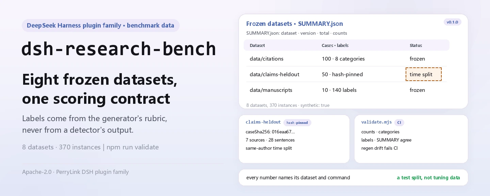
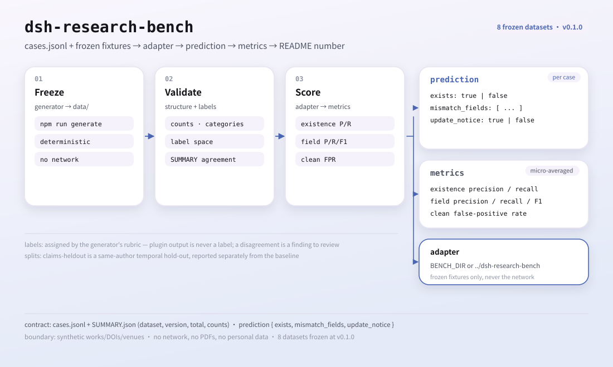
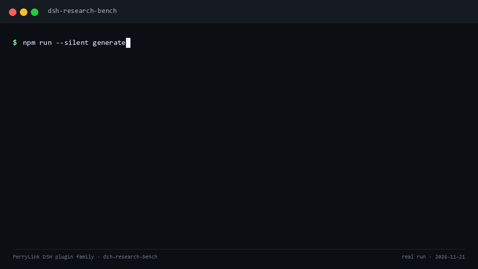

<div align="center">

<picture>
  <source media="(prefers-color-scheme: dark)" srcset="docs/assets/dsh-research-bench-hero-en-dark.webp">
  
</picture>

# dsh-research-bench

**DSH रिसर्च प्लगइन परिवार के लिए खुले, सिंथेटिक, फ़्रोज़न बेंचमार्क।**

*डेटा + रूब्रिक + एक स्कोरिंग कॉन्ट्रैक्ट — कोई प्लगइन नहीं। किसी डिटेक्टर का README केवल इस रिपॉज़िटरी द्वारा उत्पादित संख्याएँ उद्धृत कर सकता है।*

[English](README.md) · [简体中文](README-zh.md) · [Español](README-es.md) · [Português](README-pt.md) · [हिन्दी](README-hi.md)

[](LICENSE)
[]()

</div>

---

## यह क्यों मौजूद है

परिवार का हर प्लगइन कुछ *सत्यापित* करने का दावा करता है। बिना माप के दावा मार्केटिंग है, इसलिए:

- डेटासेट **सिंथेटिक और फ़्रोज़न** हैं (कोई कॉपीराइट PDF नहीं, कोई व्यक्तिगत डेटा नहीं, कोई स्क्रेप किया गया कॉर्पस नहीं);
- लेबल **जनरेटर के रूब्रिक** से आते हैं, किसी प्लगइन के आउटपुट से कभी नहीं;
- हर प्लगइन जो सटीकता प्रकाशित करना चाहता है, उसे एक **एडाप्टर** देना होगा जो इन फ़ाइलों को पढ़े और confusion matrix छापे;
- प्लगइन README में संख्याओं के साथ डेटासेट संस्करण और सटीक कमांड लिखा होना चाहिए।


<picture>
  <source media="(prefers-color-scheme: dark)" srcset="docs/assets/dsh-research-bench-flow-v5-dark.svg">
  
</picture>

*संरचना: फ़्रीज़ → सत्यापन → स्कोर। अंदर जाते हैं `cases.jsonl` और फ़्रोज़न प्रोवाइडर फ़िक्स्चर; बाहर आते हैं प्रति-केस भविष्यवाणी (`exists`, `mismatch_fields`, `update_notice`) और micro-औसत मेट्रिक्स। लेबल जनरेटर के रूब्रिक से आते हैं, किसी प्लगइन से कभी नहीं, और हर प्रकाशित संख्या को अपना डेटासेट संस्करण और उसे उत्पन्न करने वाला कमांड बताना चाहिए।*

## डेटासेट

| डेटासेट | केस | स्थिति | उपभोक्ता |
|---|---:|---|---|
| `data/citations` | **100** | ✅ फ़्रोज़न | `dsh-cite-verify` |
| `data/stats` | **30** | ✅ फ़्रोज़न | `dsh-statcheck` |
| `data/claims` | **50** | ✅ फ़्रोज़न | `dsh-claim-check` |
| `data/images` | **100 जोड़े** | ✅ फ़्रोज़न | `dsh-image-integrity` |
| `data/meta` | **20** | ✅ फ़्रोज़न | `dsh-meta-analysis` |
| `data/claims-heldout` | **50** | ✅ फ़्रोज़न | `dsh-claim-check` (अलग held-out सेट) |
| `data/repro` | 10 | 🚧 `dsh-repro-audit` (W2) के साथ | `dsh-repro-audit` |
| `data/manuscripts` | **10** | ✅ फ़्रोज़न | `dsh-manuscript-check` |
| `data/figures` | 100 जोड़े | 🚧 `dsh-image-integrity` (W4) के साथ | `dsh-image-integrity` |

### `data/repro` (v0.1.0, फ़्रोज़न)

दस रेसिपी-आधारित प्रोजेक्ट फ़िक्स्चर जो एक अस्थायी डायरेक्टरी में बनते हैं (कोई `.git` कमिट नहीं): साफ़, seed/lockfile अनुपस्थित, बिना git, गंदा ट्री, रन कमांड/एनवायरनमेंट पिन अनुपस्थित, और मैनिफ़ेस्ट के बाद के तीन ड्रिफ़्ट केस। स्तर और सटीक gap सेट रेसिपी द्वारा निर्धारित होते हैं; प्लगइन README स्तर-सटीकता, gap precision/recall, ड्रिफ़्ट पहचान और git पूर्वापेक्षा रिपोर्ट करता है।

### `data/manuscripts` (v0.1.0, फ़्रोज़न)

दस सिंथेटिक पांडुलिपियाँ जिनमें 140 आइटम लेबल (प्रत्येक में 14 संरचना/घोषणा आइटम) और दस्तावेज़-स्तरीय `missingCoreSections` हैं। लेबल जनरेटर में निर्माण से दिए जाते हैं, डिटेक्टर से नहीं। प्लगइन README आइटम-स्तर `present`/`missing` precision/recall रिपोर्ट करता है और कहता है कि यह कीवर्ड-पहचान का रिग्रेशन बेसलाइन है, अनुपालन ऑडिट नहीं।

### `data/claims-heldout` (v0.1.0, फ़्रोज़न)

बेसलाइन फ़्रीज़ होने के बाद लिखे गए 50 नए claim/source जोड़े, 7 नए सिंथेटिक स्रोतों के साथ और बिना शब्दशः पुनरुपयोग। फ़ाइल `SUMMARY.json` में hash-पिन है, और hash बदलने पर रनर चलने से इंकार कर देता है। यह **एक ही लेखक का time-split** है, अंधा या निष्पक्ष अनुमान नहीं: लेखक ने केस लिखने से पहले कार्यान्वयन पढ़ा था। परिणाम बेसलाइन से अलग रिपोर्ट किए जाते हैं।

### `data/meta` (v0.1.0, फ़्रोज़न)

20 सिंथेटिक मेटा-विश्लेषण (153 अध्ययन पंक्तियाँ) जो समरूपता, मध्यम/उच्च विषमता, शून्य/ऋणात्मक प्रभाव, k=2/5/10/12 और समान/असमान SE को कवर करते हैं। अपेक्षित fixed/random अनुमान, Q, I² और τ² जनरेटर में एक स्वतंत्र closed-form कार्यान्वयन से गणना किए जाते हैं, प्लगइन से नहीं; प्लगइन README मापी गई अधिकतम निरपेक्ष त्रुटि और सीमाएँ रिपोर्ट करता है (वही DL मॉडल, कोई missingness नहीं)।

### `data/images` (v0.1.0, फ़्रोज़न)

100 सिंथेटिक 64×64 PNG जोड़े: 25 डुप्लिकेट-ब्लॉक, 25 मिरर-ब्लॉक, 25 असंबंधित और 25 कठिन-नकारात्मक जोड़े जो केवल सपाट किनारे साझा करते हैं। लेबल जनरेटर से आते हैं, डिटेक्टर से कभी नहीं। डिटेक्टर के अपने README को मापी गई precision/recall और FPR उद्धृत करनी चाहिए, और बताना चाहिए कि फ़िक्स्चर ग्रिड-संरेखित और असंपीड़ित हैं।

### `data/claims` (v0.1.0, फ़्रोज़न)

पाँच सिंथेटिक पैराग्राफ़ों पर 50 दावे: 15 समर्थित (`verified`), 10
पैराफ़्रेज़ (**`insufficient`, डिज़ाइन से** — v0.1 अर्थ-विश्लेषण नहीं करता), 8 संख्या-गलत
(`disproven`), 7 निषेध-विपर्यय और 5 उद्धरण-माइन (`contradicted`),
5 अनुपस्थित-सामग्री (`insufficient`)। स्कीमा:
[`schema/claim-case.schema.json`](schema/claim-case.schema.json); नियम और
वैधता चेतावनी: [`rubric/CLAIMS.md`](rubric/CLAIMS.md).

> **वैधता चेतावनी।** v0.1 claim केस `dsh-claim-check` के नियमों वाले उसी रूब्रिक से लिखे गए थे
> और एक supported केस विफल होने के बाद एक नियम सुधारा गया। इस सेट पर 1.0 संख्याएँ
> **रिग्रेशन बेसलाइन हैं, वास्तविक पांडुलिपि सटीकता का निष्पक्ष अनुमान नहीं**। कार्यान्वयन को
> संदर्भित किए बिना लिखा गया held-out सेट अभी भी योजना में है।

### `data/stats` (v0.1.0, फ़्रोज़न)

प्रकाशित क्रिटिकल मानों के आसपास 30 सिंथेटिक वाक्य: 10 संगत (रिपोर्ट किया गया p वही
प्रायिकता है जिससे रिपोर्ट किया गया क्रिटिकल सांख्यिकी मेल खाता है)
और 20 असंगत (गलत p, गलत थ्रेशोल्ड, CI जो सार्थक p का विरोध करता है,
`p = .000`, `p > 1`)। लेबल क्रिटिकल-मान तालिकाओं से आते हैं — प्लगइन से नहीं।
प्रारूप: [`schema/stat-case.schema.json`](schema/stat-case.schema.json);
नियम: [`rubric/STATS.md`](rubric/STATS.md).

### `data/citations` (v0.1.0, फ़्रोज़न)

100 केस, आठ श्रेणियाँ, प्रत्येक के साथ **फ़्रोज़न प्रोवाइडर प्रतिक्रियाएँ** जो प्लगइन को मिलतीं:

| श्रेणी | केस | क्या गलत है |
|---|---:|---|
| `correct` | 30 | कुछ नहीं — चिह्नित नहीं होना चाहिए |
| `wrong-author` | 20 | पहला लेखक बदला / अतिरिक्त लेखक उद्धृत |
| `wrong-year` | 15 | वर्ष 1, 2 या 10 साल का अंतर |
| `wrong-doi` | 15 | 8 अनसुलझने योग्य DOI, 7 DOI जो दूसरे काम की ओर इशारा करते हैं |
| `retracted` | 8 | रिकॉर्ड में retraction सूचना है |
| `correction` | 6 | रिकॉर्ड में correction सूचना है |
| `preprint` | 4 | arXiv और प्रकाशित DOI सहमत हैं |
| `disagreement` | 2 | PubMed और Crossref शीर्षक असहमत हैं |

हर काम, DOI (`10.5555/...`), लेखक और venue **काल्पनिक** है। फ़िक्स्चर प्रतिक्रियाएँ जनरेटर बनाता है, इसलिए बेंचमार्क प्लगइन की *जाँच-तर्क* मापता है, Crossref की उपलब्धता नहीं।

प्रारूप: प्रति पंक्ति एक JSON ऑब्जेक्ट, स्कीमा [`schema/citation-case.schema.json`](schema/citation-case.schema.json) में। लेबल परिभाषाओं और मेट्रिक कॉन्ट्रैक्ट के लिए [`rubric/CITATIONS.md`](rubric/CITATIONS.md) देखें।

## स्कोरिंग कॉन्ट्रैक्ट

प्लगइन एडाप्टर प्लगइन रिपॉज़िटरी में एक स्क्रिप्ट है जो:

1. `cases.jsonl` पढ़ता है (पथ `BENCH_DIR` से, अन्यथा `../dsh-research-bench`)।
2. केस के फ़्रोज़न प्रोवाइडर फ़िक्स्चर के विरुद्ध प्लगइन की अपनी पाइपलाइन चलाता है (कोई नेटवर्क नहीं)।
3. प्रति केस एक भविष्यवाणी बनाता है:
   ```json
   { "exists": true, "mismatch_fields": ["title"], "update_notice": false }
   ```
4. नीचे दिए मेट्रिक्स की गणना करता है और एक JSON रिपोर्ट तथा Markdown तालिका लिखता है।

### मेट्रिक्स (micro-औसत)

| मेट्रिक | परिभाषा |
|---|---|
| existence precision / recall | `exists=false` भविष्यवाणी बनाम `exists=false` लेबल |
| field precision / recall / F1 | `mismatch_fields` में `(case, field)` जोड़ों पर |
| update-notice precision / recall | `update_notice` पर |
| clean false-positive rate | `correct` केसों का अनुपात जिनमें कोई फ़ील्ड चिह्नित, `update_notice`, या `not_found` निर्णय है |
| case exact match | उन केसों का अनुपात जिनमें existence **और** फ़ील्ड सेट **और** notice फ़्लैग तीनों मेल खाते हैं |

प्लगइन README को ऊपर के सभी मेट्रिक्स रिपोर्ट करने होंगे (या स्पष्ट रूप से बताना होगा कि कौन सा नहीं रिपोर्ट करता और क्यों), डेटासेट संस्करण और उन्हें उत्पन्न करने वाले कमांड के साथ।

## पुनरुत्पादन



*एनिमेटेड: असली stdout। ऊपर जनरेटर (`npm run generate`, npm बैनर हटाने के लिए `--silent` के साथ चलाया गया); नीचे वैलिडेटर (`node scripts/validate.mjs`), टर्मिनल के लिए `fold` से लपेटा गया। दोनों 2026-11-21 को फिर से चलाए गए; पुनर्जनन के बाद `git status` साफ़ रहा।*


```sh
npm run generate        # deterministic; rewrites data/citations, data/stats, data/claims, data/claims-heldout, data/images, data/meta, data/manuscripts and data/repro
npm run validate        # structure + counts + categories + label space + SUMMARY agreement
```

CI दोनों चलाता है और यदि पुनर्जनन किसी कमिट की गई फ़ाइल को बदल दे तो विफल हो जाता है — डेटासेट चुपचाप ड्रिफ़्ट नहीं हो सकता।

## लाइसेंस और स्रोत

- कोड और डेटा: Apache-2.0.
- कोई तृतीय-पक्ष कॉर्पस नहीं, कोई पेपर PDF नहीं, कोई वास्तविक उद्धरण नहीं, कोई व्यक्तिगत डेटा नहीं।
- प्रोवाइडर प्रतिक्रियाएँ असली API के आकार वाले सिंथेटिक फ़िक्स्चर हैं; वे लाइव सेवाओं से **रिकॉर्ड नहीं** किए गए और उन्हें किसी वास्तविक पेपर के बारे में साक्ष्य के रूप में कभी प्रस्तुत नहीं करना चाहिए।

## सीमाएँ

- सिंथेटिक कामों में साफ़, अंग्रेज़ी, सुगठित मेटाडेटा है; वास्तविक ग्रंथसूचियों में ट्रांसलिटरेशन, नाम-कण, सुपरस्क्रिप्ट और venue संक्षेपण होते हैं जिन्हें यह सेट अभ्यास नहीं करता।
- फ़्रोज़न फ़िक्स्चर प्रोवाइडर-पक्ष प्रारूप परिवर्तन नहीं पकड़ सकते; वे प्लगइन के अपने टेस्ट कवर करते हैं।
- लेबल *इस* रिपॉज़िटरी का रूब्रिक एनकोड करते हैं। प्लगइन और लेबल के बीच असहमति समीक्षा के लिए एक निष्कर्ष है, स्वतः प्लगइन बग नहीं।
- सभी आठ डेटासेट v0.1.0 पर फ़्रोज़न हैं: citations, stats, claims, claims-heldout, images, meta, manuscripts और repro।
- claims v0.1 सेट सह-डिज़ाइन किया गया रिग्रेशन बेसलाइन है (ऊपर चेतावनी देखें); यह held-out टेस्ट सेट नहीं है।

## वर्ज़निंग

`0.x` जब तक डेटासेट जोड़े जा रहे हैं। डेटासेट संस्करण (`dataset`, `version`, `total`) प्रत्येक `SUMMARY.json` में रहता है; फ़्रोज़न डेटासेट के लेबल या केस बदलने पर संस्करण बढ़ाना और [`CHANGELOG.md`](CHANGELOG.md) में नोट लिखना आवश्यक है।
