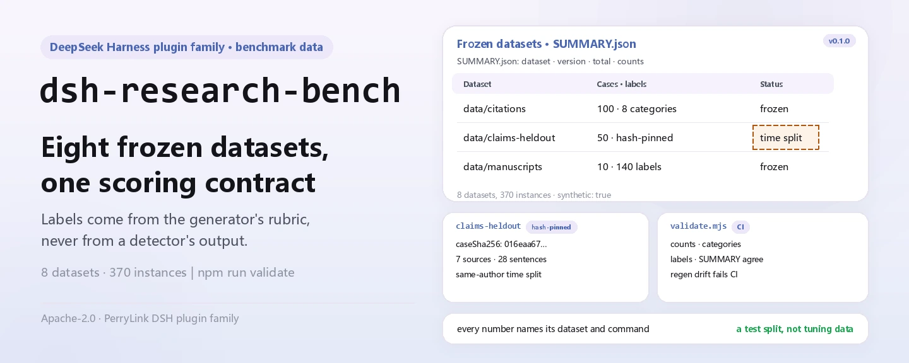
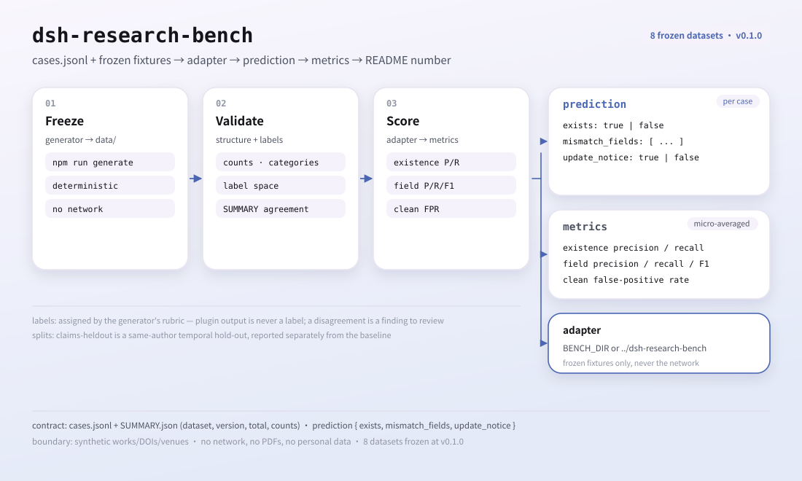

<div align="center">

<picture>
  <source media="(prefers-color-scheme: dark)" srcset="docs/assets/dsh-research-bench-hero-en-dark.webp">
  
</picture>

# dsh-research-bench

**Benchmarks abertos, sintéticos e congelados para a família de plugins de pesquisa do DSH.**

*Dados + rubrica + um contrato de pontuação — não é um plugin. O README de um detector só pode citar números produzidos por este repositório.*

[English](README.md) · [简体中文](README-zh.md) · [Español](README-es.md) · [Português](README-pt.md) · [हिन्दी](README-hi.md)

[](LICENSE)
[]()

</div>

---

## Por que isto existe

Cada plugin da família afirma *verificar* algo. Uma afirmação sem medição é marketing, então:

- os conjuntos de dados são **sintéticos e congelados** (sem PDFs protegidos por direitos autorais, sem dados pessoais, sem corpus raspados);
- os rótulos vêm da **rubrica do gerador**, nunca da saída de um plugin;
- todo plugin que queira publicar acurácia precisa incluir um **adaptador** que leia esses arquivos e imprima uma matriz de confusão;
- os números no README de um plugin devem indicar a versão do conjunto de dados e o comando exato.


<picture>
  <source media="(prefers-color-scheme: dark)" srcset="docs/assets/dsh-research-bench-flow-v5-dark.svg">
  
</picture>

*Estrutura: congelar → validar → pontuar. Entram `cases.jsonl` e os fixtures de provedor congelados; saem uma previsão por caso (`exists`, `mismatch_fields`, `update_notice`) e métricas de média micro. Os rótulos vêm da rubrica do gerador, nunca de um plugin, e todo número publicado deve indicar a versão do conjunto de dados e o comando que o produziu.*

## Conjuntos de dados

| Conjunto | Casos | Estado | Consumidor |
|---|---:|---|---|
| `data/citations` | **100** | ✅ congelado | `dsh-cite-verify` |
| `data/stats` | **30** | ✅ congelado | `dsh-statcheck` |
| `data/claims` | **50** | ✅ congelado | `dsh-claim-check` |
| `data/images` | **100 pares** | ✅ congelado | `dsh-image-integrity` |
| `data/meta` | **20** | ✅ congelado | `dsh-meta-analysis` |
| `data/claims-heldout` | **50** | ✅ congelado | `dsh-claim-check` (conjunto de retenção separado) |
| `data/repro` | 10 | 🚧 com `dsh-repro-audit` (W2) | `dsh-repro-audit` |
| `data/manuscripts` | **10** | ✅ congelado | `dsh-manuscript-check` |
| `data/figures` | 100 pares | 🚧 com `dsh-image-integrity` (W4) | `dsh-image-integrity` |

### `data/repro` (v0.1.0, congelado)

Dez fixtures de projeto baseados em receitas, materializados em um diretório temporário (sem `.git` confirmado): limpo, sem seed/lockfile, sem git, árvore suja, sem comando de execução/fixação de ambiente, e três casos de deriva posteriores ao manifesto. Os níveis e os conjuntos exatos de gaps são atribuídos pela receita; o README do plugin reporta acurácia de nível, precision/recall de gaps, detecção de deriva e o pré-requisito de git.

### `data/manuscripts` (v0.1.0, congelado)

Dez manuscritos sintéticos com 140 rótulos de item (14 itens de estrutura/declaração cada) e `missingCoreSections` no nível do documento. Os rótulos são atribuídos por construção no gerador, não pelo detector. O README do plugin reporta precision/recall de `present`/`missing` no nível do item e declara que isto é uma base de regressão de detecção por palavras-chave, não uma auditoria de conformidade.

### `data/claims-heldout` (v0.1.0, congelado)

50 pares claim/source novos escritos depois de congelar a base, com 7 fontes sintéticas novas e sem reutilização literal. O arquivo é fixado por hash em `SUMMARY.json`, e o runner se recusa a executar se o hash mudou. É um **time-split do mesmo autor**, não uma estimativa cega ou não enviesada: o autor leu a implementação antes de escrever os casos. Os resultados são reportados separadamente da base.

### `data/meta` (v0.1.0, congelado)

20 metanálises sintéticas (153 linhas de estudo) cobrindo homogeneidade, heterogeneidade média/alta, efeitos zero/negativos, k=2/5/10/12 e SEs iguais/desiguais. As estimativas esperadas fixas/aleatórias, Q, I² e τ² são calculadas por uma implementação fechada independente no gerador, não pelo plugin; o README do plugin reporta o erro absoluto máximo medido e os limites (mesmo modelo DL, sem dados faltantes).

### `data/images` (v0.1.0, congelado)

100 pares de PNG sintéticos de 64×64: 25 pares de blocos duplicados, 25 de blocos espelhados, 25 não relacionados e 25 negativos difíceis que compartilham apenas bordas planas. Os rótulos vêm do gerador, nunca do detector. O README do próprio detector deve citar a precision/recall e a FPR medidas, e deve declarar que os fixtures são alinhados à grade e não comprimidos.

### `data/claims` (v0.1.0, congelado)

50 afirmações sobre cinco parágrafos sintéticos: 15 sustentadas (`verified`), 10
paráfrases (**`insufficient` por design** — v0.1 não faz semântica), 8 com
números errados (`disproven`), 7 com negação invertida e 5 com citações enviesadas (`contradicted`),
5 com conteúdo ausente (`insufficient`). Esquema:
[`schema/claim-case.schema.json`](schema/claim-case.schema.json); regras e a
ressalva de validade: [`rubric/CLAIMS.md`](rubric/CLAIMS.md).

> **Ressalva de validade.** Os casos de claim v0.1 foram escritos com a mesma rubrica das
> regras do `dsh-claim-check` e uma regra foi corrigida depois que um caso supported falhou.
> Os números 1.0 deste conjunto são uma **base de regressão, não uma estimativa não enviesada**
> da acurácia em manuscritos reais. Um conjunto de retenção escrito sem referência à
> implementação ainda está planejado.

### `data/stats` (v0.1.0, congelado)

30 frases sintéticas em torno de valores críticos publicados: 10 consistentes (o p
reportado é a probabilidade à qual o estatístico crítico reportado corresponde)
e 20 inconsistentes (p errado, limiar errado, CI que contradiz um p
significativo, `p = .000`, `p > 1`). Os rótulos vêm das tabelas de valores críticos — não do
plugin. Formato: [`schema/stat-case.schema.json`](schema/stat-case.schema.json);
regras: [`rubric/STATS.md`](rubric/STATS.md).

### `data/citations` (v0.1.0, congelado)

100 casos, oito categorias, cada um com as **respostas de provedor congeladas** que o plugin teria recebido:

| Categoria | Casos | O que está errado |
|---|---:|---|
| `correct` | 30 | nada — não deve ser sinalizado |
| `wrong-author` | 20 | primeiro autor alterado / autor extra citado |
| `wrong-year` | 15 | ano desviado em 1, 2 ou 10 anos |
| `wrong-doi` | 15 | 8 DOIs não resolvíveis, 7 DOIs apontando para outro trabalho |
| `retracted` | 8 | o registro carrega um aviso de retratação |
| `correction` | 6 | o registro carrega um aviso de correção |
| `preprint` | 4 | arXiv e o DOI publicado concordam |
| `disagreement` | 2 | os títulos do PubMed e do Crossref discordam |

Cada trabalho, DOI (`10.5555/...`), autor e venue é **fictício**. As respostas fixture são construídas pelo gerador, então o benchmark mede a *lógica de checagem* de um plugin, não a disponibilidade do Crossref.

Formato: um objeto JSON por linha, esquema em [`schema/citation-case.schema.json`](schema/citation-case.schema.json). Veja [`rubric/CITATIONS.md`](rubric/CITATIONS.md) para as definições de rótulos e o contrato de métricas.

## Contrato de pontuação

Um adaptador de plugin é um script no repositório do plugin que:

1. Lê `cases.jsonl` (caminho de `BENCH_DIR`, senão `../dsh-research-bench`).
2. Executa o pipeline do próprio plugin contra os fixtures de provedor congelados do caso (sem rede).
3. Produz, por caso, uma previsão:
   ```json
   { "exists": true, "mismatch_fields": ["title"], "update_notice": false }
   ```
4. Calcula as métricas abaixo e escreve um relatório JSON mais uma tabela Markdown.

### Métricas (média micro)

| Métrica | Definição |
|---|---|
| existence precision / recall | previsão `exists=false` contra o rótulo `exists=false` |
| field precision / recall / F1 | sobre pares `(case, field)` em `mismatch_fields` |
| update-notice precision / recall | sobre `update_notice` |
| clean false-positive rate | proporção de casos `correct` com algum campo sinalizado, `update_notice`, ou um veredito `not_found` |
| case exact match | proporção de casos em que existência **e** o conjunto de campos **e** a flag de aviso coincidem |

Um README de plugin deve reportar tudo o que está acima (ou declarar explicitamente o que não reporta e por quê), com a versão do conjunto de dados e o comando que os produziu.

## Reproduzir


*Animado: stdout real. Acima, o gerador (`npm run generate`, executado com `--silent` para remover o banner do npm); abaixo, o validador (`node scripts/validate.mjs`), quebrado com `fold` para o terminal. Ambos reexecutados em 2026-11-21; a regeneração deixou `git status` limpo.*


```sh
npm run generate        # deterministic; rewrites data/citations, data/stats, data/claims, data/claims-heldout, data/images, data/meta, data/manuscripts and data/repro
npm run validate        # structure + counts + categories + label space + SUMMARY agreement
```

O CI executa ambos e falha se a regeneração alterar um arquivo confirmado — o conjunto de dados não pode derivar em silêncio.

## Licença e procedência

- Código e dados: Apache-2.0.
- Sem corpus de terceiros, sem PDFs de artigos, sem citações reais, sem dados pessoais.
- As respostas de provedor são fixtures sintéticos com a forma das APIs reais; **não** foram gravadas dos serviços ao vivo e nunca devem ser apresentadas como evidência sobre um artigo real.

## Limitações

- Os trabalhos sintéticos têm metadados limpos, em inglês e bem formados; bibliografias reais contêm transliteração, partículas de nomes, sobrescritos e abreviações de venue que este conjunto não exercita.
- Fixtures congelados não conseguem captar mudanças de formato do lado do provedor; essas são cobertas pelos testes dos próprios plugins.
- Os rótulos codificam a rubrica de *este* repositório. Uma discordância entre um plugin e um rótulo é um achado a revisar, não automaticamente um bug do plugin.
- Os oito conjuntos de dados estão congelados em v0.1.0: citations, stats, claims, claims-heldout, images, meta, manuscripts e repro.
- O conjunto claims v0.1 é uma base de regressão co-desenhada (veja a ressalva acima); não é um conjunto de teste retido.

## Versionamento

`0.x` enquanto conjuntos de dados são adicionados. A versão de um conjunto de dados (`dataset`, `version`, `total`) fica em cada `SUMMARY.json`; alterar rótulos ou casos de um conjunto congelado exige um aumento de versão e uma nota no [`CHANGELOG.md`](CHANGELOG.md).
